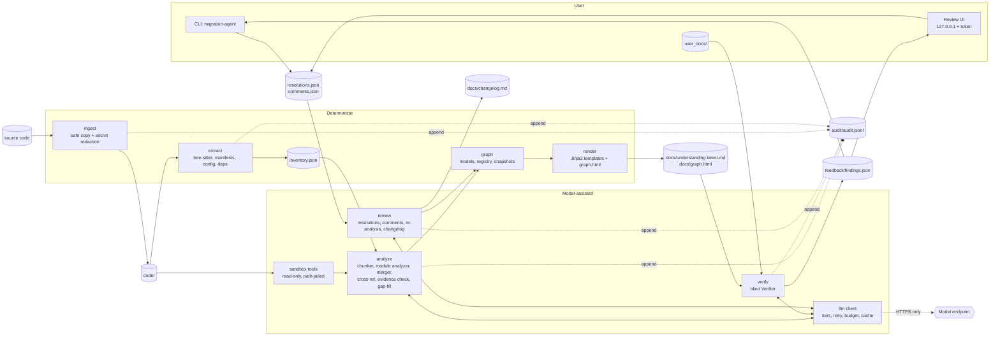

# Architecture

## Goals and constraints

1. **Evidence or it did not happen.** Every graph node and edge carries file/line/quote evidence that is checked
   against the real source; confidence is *derived* from evidence, never asserted by the model.
2. **Read-only and non-executing.** The source is copied once; nothing is run; the model has a jailed read-only tool set.
3. **The folder is the state.** One project folder holds all inputs, intermediate results and outputs, so a run
   can be resumed, diffed, backed up and audited with ordinary tools.
4. **Independent verification.** The Verifier sees documentation and the generated document, never the code.
5. **Human in the loop.** Findings feed a review/resolve cycle that re-analyses only what is disputed.

## Component diagram

## Data flow

1. `init` creates the folder and `project.json`.
2. **ingest** normalises the source into `code/` and writes `ingest_report.json`.
3. **extract** parses with tree-sitter and manifest/config parsers. Output: `facts/*.json` and `inventory.json`,
   the checklist of everything that must be explained (files, routes, config keys, dependencies).
4. **analyze**
   1. `chunker` splits the code into token-bounded chunks along structural boundaries and plans cost.
   2. `module_analyzer` asks the model (task `chunk_extract`) for a *patch* (nodes/edges with evidence) per chunk;
      patches are persisted in `checkpoint/` so an interrupted run resumes.
   3. `merger` combines patches, allocating stable IDs through `graph/registry.json`.
   4. `crossref` resolves references that span chunks, using the read-only tools.
   5. `rules` extracts business rules; `gapfill` revisits inventory items that nothing mapped.
   6. `evidence.verify_evidence` re-checks every quote against `code/`; failing claims are rejected or demoted.
   7. `coverage` computes the inventory coverage matrix.
   8. `graph.store.save_snapshot` writes `graph/snapshots/vNNN.json` and `graph/latest.json`; `render` produces the
      document and `viz` the interactive `graph.html`.
5. **verify** extracts claims from the document and from `user_docs/`, compares them, drops findings whose quotes
   do not occur verbatim, writes `feedback/findings.json`.
6. **review / resolve** record `resolutions.json` and `comments.json`; `review.reanalyze` re-reads only the code around
   the affected nodes, merges a new snapshot, marks feedback processed and `review.changelog` writes
   `docs/changelog.md` from snapshot diffs.

## Trust boundaries

| Boundary | Control |
|---|---|
| Source -> project | `ingest`: archive validation, size limits, no execution, secret withholding/redaction |
| Project -> model | Only `code/` content via jailed tools and prompts; secrets already redacted; text from code, docs and reviewers wrapped in non-forgeable delimiters and treated as data |
| Model -> graph | Strict pydantic models (`extra="forbid"`); evidence verified against real files; IDs allocated by the registry, not the model |
| User docs <-> code | The Verifier never receives code; analysis never receives user docs |
| Process -> network | Optional in-process guard; in Docker, `network_mode: none` or an `internal` network whose only exit is an allowlisting Squid proxy |
| Reviewer -> project | Loopback-only server, token, Host/Origin checks, narrow write API (comments, resolutions) |

## Key design decisions

* **Derived confidence** (`graph.models.derive_confidence`): `high` needs two strongly evidenced items (line range or
  symbol plus a verbatim quote); `medium` one, or several weak ones; `low` one weak; `none` no evidence.
* **Stable IDs**: `Registry` maps `(type, module, symbol)` to an ID for the life of the project so snapshots diff cleanly.
* **Snapshots, not mutation**: graph versions are immutable files; `latest.json` is a pointer (no symlinks), so
  diffs, changelogs and rollbacks are trivial.
* **Budget and cache**: `Budget` is checked before every call using a token estimate; `llm_cache/` is keyed by
  model, system, prompt and prompt version; the audit log records tokens and USD per call.
* **Atomic writes** (temp file + `os.replace`) for all feedback and graph files; audit appends use `O_APPEND` plus `flock`.
* **Model-agnostic**: `LLMClient` is a one-method protocol; LiteLLM implements it, `OfflineLLM` and `FakeLLM` stand in for tests and `--offline`.
* **Container is the boundary**; the in-process guard is a tripwire. See `src/migration_agent/sandbox/README.md`
  for what it does and does not stop.

## Module map

| Package / module | Role |
|---|---|
| `cli.py` | Click entry point, `.env` loading |
| `project.py` | Folder layout, metadata |
| `ingest/` | Safe copy, secret scanning/redaction |
| `extract/` | tree-sitter AST facts, manifests, config keys, static dependencies |
| `pipeline.py` | Inventory, facts-only graph, minimal doc |
| `analyze/` | LLM analysis pipeline and prompts (`analyze/prompts/*.md`) |
| `graph/` | Models, ID registry, snapshot store and diffs |
| `llm/` | Client protocol, LiteLLM adapter, offline stand-in |
| `verify/` | User-doc conversion, blind Verifier, contracts (`verify/models.py`) |
| `review/` | Resolutions, comments, targeted re-analysis, changelog |
| `review_ui/` | Local HTTP server and single-page UI |
| `render.py`, `templates/` | Understanding document |
| `viz/` | Standalone interactive graph page |
| `sandbox/` | Read-only tools, process guard |
| `audit.py` | JSONL audit log |
| `config_env.py` | `MA_*` environment configuration |
| `evalharness.py`, `eval/` | Scoring against hand-labelled reference repos |

## Known limits

Static extraction supports the languages tree-sitter-language-pack covers; unsupported or unparsable files
are marked `parse_status: fallback` (listed in the document). The model sees only chunks and tool results; behaviour that
exists only at runtime (reflection, generated code, data in databases) shows up as blind spots, not facts.
