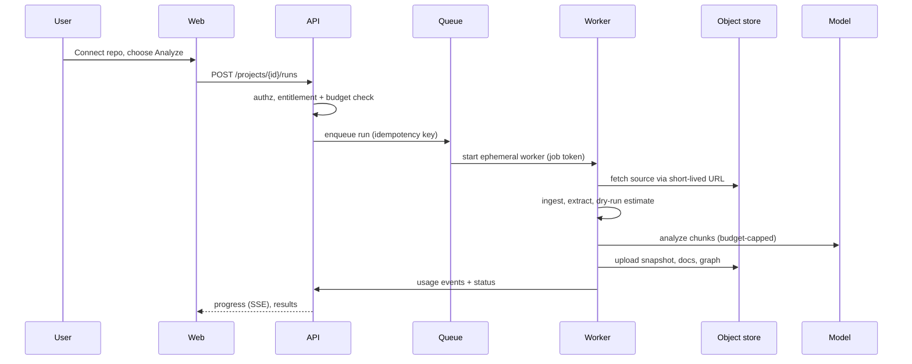

# Product architecture and roadmap: from CLI engine to hosted service

Status: proposal, v1. Scope: architecture and plan only. No code changed, **no billing provider chosen or built**
(decision deferred by the owner; this plan only leaves clean seams for it).
Evidence is cited as `path:line` or `path`. **[Inferred]** = my judgement from the code, **[Unknown]** = needs an answer
from the owner or from measurement.

## 1. Verdict

The analysis engine is real and unusually disciplined: evidence-checked claims, derived confidence, a blind Verifier,
budget and cache controls, 576 passing tests, ~9.4k lines (`docs/architecture.md`). That is the hard, differentiated part.
**Everything around it is not a product yet.** It is a single-user CLI whose only state is a local folder, whose only UI
is a loopback server that refuses any other address, and which has no accounts, tenancy, job system, metering or
hosted storage (`docs/architecture.md:Trust boundaries`, `src/migration_agent/review_ui/server.py`).

Top risks, in order:

1. **Unproven quality at real scale.** The evaluation repos are hand-built, small stand-ins: 8, 11 and 18 files, and the
   README says the "~100 file" and "~500 file" targets were scaled down (`eval/README.md`). Customers will bring
   100k+ line repos. Until accuracy and cost per repo are measured on real code, every price and promise is a guess.
2. **Customer source code is the crown jewel.** A hosted version concentrates other companies' proprietary code. One
   isolation failure ends the business. The current design (read-only, jailed tools, secret redaction, egress allowlist)
   is a strong base, but it is built for one trusted operator.
3. **State model does not fit multi-tenant SaaS.** The folder is the state (`src/migration_agent/project.py`), writes use
   local `os.replace` and `flock`. Fine on one disk, wrong for stateless workers.
4. **Positioning.** The tool is called migration-agent but what it delivers is *verified understanding of a legacy
   system*. That is a sharper, more defensible promise than "migration", and it should drive the name, the landing page
   and the first customer segment. **[Inferred]**

Recommendation: keep the engine as a library, wrap it in a conventional, boring SaaS (Next.js, FastAPI, Postgres,
object storage, one job queue), and spend the first phase on proving quality and unit economics before building UI.

## 2. Context and constraints

| Item | Value | Source |
|---|---|---|
| Owner and team | One founder, income-critical, targeting Y Combinator | stated by owner |
| Stack chosen | FastAPI + Postgres + Next.js | stated by owner |
| Billing | Not decided; not to be built now | stated by owner |
| Target customer | **[Unknown]** engineering teams modernising or inheriting legacy services | needs owner decision |
| Scale target | **[Unknown]** assume tens of customers, repos up to ~1M lines in year one | assumption |
| Compliance | **[Unknown]** assume customers will ask for SOC 2 and a data-handling statement before purchase | assumption |

A one-person team is the dominant constraint. Every component below is chosen to minimise the number of things that can
page you at 3 a.m.: one database, one queue, one object store, managed hosting.

## 3. Architecture at a glance

```mermaid
flowchart LR
  subgraph Client
    WEB[Next.js app<br/>dashboard, review, graph]
  end
  subgraph Control plane
    API[FastAPI<br/>auth, tenancy, projects, jobs, usage]
    PG[(Postgres<br/>metadata, graph index, usage events)]
    Q[Job queue<br/>Postgres-backed]
    OBJ[(Object storage<br/>source tarballs, snapshots, docs)]
  end
  subgraph Data plane - per job, ephemeral
    W[Worker container<br/>existing hardened image<br/>engine as library]
    PX[Egress proxy<br/>allowlist: model host only]
  end
  GH[GitHub App<br/>read-only contents]
  LLM{{Model provider<br/>zero-retention terms}}
  WEB --> API --> PG
  API --> Q --> W
  API <--> OBJ
  GH --> API
  W <--> OBJ
  W --> PX --> LLM
  W -->|usage events, job status| API
```

Principles:

- **Control plane and data plane are separate.** The API never touches customer code. Workers touch code but hold no
  database credentials, only a short-lived, job-scoped token.
- **The engine stays a pure library.** `migration_agent` keeps working as the CLI (free, open-core marketing channel) and
  becomes the worker's job body. **[Inferred]**
- **Artifacts live in object storage; Postgres holds metadata and a queryable copy of the graph.** Snapshots are already
  immutable files (`docs/architecture.md:Snapshots, not mutation`), which maps directly to immutable objects.

## 4. Components

| Component | Responsibility | Notes |
|---|---|---|
| Web (Next.js) | Marketing site, dashboard, repo connect, run status, review UI, graph viewer | Replaces `review_ui/page.py` (301 lines) and `viz/graph_html.py` |
| API (FastAPI) | AuthN/Z, workspaces, projects, jobs, findings, comments, resolutions, usage | Re-exposes the logic behind `review_ui/server.py` `/api/state`, `/api/comments`, `/api/resolutions`, `/api/diff` |
| Postgres | Tenants, users, projects, runs, findings, comments, usage events, entitlements | Row-level security keyed on `workspace_id` |
| Queue | Run `ingest -> extract -> analyze -> verify -> resolve` as durable jobs | Start with a Postgres-backed queue; no Redis/Kafka until measured need |
| Worker | Materialise project folder in scratch, run the engine, upload artifacts, emit usage | Reuses `docker/Dockerfile` (non-root, read-only rootfs, caps dropped) |
| Egress proxy | Only allows HTTPS to the model host | Already designed (`docker/squid.conf`, compose `model` profile) |
| Object storage | Source archives, `code/`, snapshots, rendered docs, exports | Per-tenant prefix, server-side encryption, lifecycle rules |
| LLM gateway (thin) | Model routing, per-run budget, retries, provider failover | `llm/litellm_client.py` plus `MA_*` config already cover most of this |

## 5. Data model (entity level)

- **Workspace** (tenant), **User**, **Membership(role)**.
- **Repository** (source: GitHub App install + repo, or upload), **Project** (one analysable unit, optionally a subpath).
- **Run** (type, status, engine version, model config, budget, started/finished) -> **Artifact** (object key, kind, hash).
- **GraphSnapshot** (immutable, version, run) -> **Node**, **Edge** (type, stable ID from the registry, confidence,
  evidence list). Indexed in Postgres for the UI; the snapshot file stays the source of truth.
- **UserDoc** (uploaded documentation for the Verifier), **Finding**, **Resolution**, **Comment**.
- **UsageEvent** (workspace, run, model, input/output tokens, provider cost, timestamp). Derived from the existing
  per-call audit record (`src/migration_agent/audit.py`).
- **Plan** and **Entitlement** (limits such as repos, lines analysed per month, seats). Plain tables with **no provider
  coupling**; see section 9.
- **AuditLog** (who did what), separate from usage.

Consistency: strong within Postgres; artifacts are write-once and referenced by hash, so job retries are idempotent.

## 6. Key flows

**Connect and analyse a repo**



**Review and resolve**: findings and comments are API writes; "needs re-analysis" enqueues a targeted re-analysis job,
which reuses `review/reanalyze.py`, produces a new immutable snapshot, and updates the changelog.

**Cost guard**: a run is created only after a dry-run estimate (the engine already prints one, `analyze --dry-run`),
compared with the workspace entitlement. The engine's own `--max-usd` becomes a hard per-run ceiling.

## 7. Required engine changes (the seams)

| # | Change | Why | Effort |
|---|---|---|---|
| E1 | Introduce a `Storage` abstraction under `Project` (local folder first, then object-store-backed with a scratch copy) | Stateless workers; resume after crash on another machine | M |
| E2 | Replace file-locking and local atomic writes with "work in scratch, publish artifacts at the end" | `flock` and `os.replace` assume one disk | S |
| E3 | Emit structured progress and usage events through a callback | Live progress and metering | S |
| E4 | Inject credentials and budget per run, never from process env | Multi-tenant keys, per-run ceilings | S |
| E5 | Make the review logic importable (not tied to the HTTP handler) | API reuses it | M |
| E6 | Keep the CLI and the library API stable and versioned | Open-core CLI plus hosted product share one engine | S |

These are refactors with the existing 576 tests as the safety net. Nothing here requires rewriting the analysis.

## 8. Security and trust (the product's real moat)

Customers will buy on trust. Findings against the target design, most severe first:

| ID | Sev | Finding | Recommendation | Trade-off |
|---|---|---|---|---|
| SEC-1 | Critical | Tenant data isolation does not exist yet (single-user design) | RLS on every table, tenant-prefixed object keys, tests that attempt cross-tenant reads, no shared caches without tenant in the key. Note `llm_cache/` is keyed by prompt hash (`docs/architecture.md:Budget and cache`); cache must be per-tenant or two tenants with identical code would share responses | Slightly lower cache hit rate |
| SEC-2 | Critical | Hosted worker runs on shared infrastructure with customer code | One ephemeral container per run, existing hardening (non-root, read-only rootfs, caps dropped, egress allowlist), no database credentials in the worker, destroy on completion | Cold-start latency and per-run overhead |
| SEC-3 | High | Model provider sees customer code | Contractual zero-retention terms, document it plainly, offer a self-hosted/BYO-key tier later (`MA_LLM_API_BASE` already supports custom endpoints) | BYO tier is more support |
| SEC-4 | High | User-supplied git URLs and archives (SSRF, zip bombs) | Existing archive limits and no-hook clones help (`docs/user-guide.md` ingest section). Add URL allowlist and block private/link-local ranges server-side; prefer GitHub App over arbitrary URLs | Fewer source types at launch |
| SEC-5 | High | Secrets in customer repos | Existing withhold/redact at ingest is a genuine asset. Add secret-scan reporting to the customer and never log source content | None |
| SEC-6 | Medium | Prompt injection through repo contents | Already tested with canaries (`eval/README.md` gates). Keep as a release gate and grow the corpus | Ongoing maintenance |
| SEC-7 | Medium | Account security | Use a hosted identity provider (do not hand-roll auth), MFA, short sessions, SSO for team tier later | Vendor dependency |
| SEC-8 | Medium | Auditability | Append-only audit log of access to a customer's data, exportable | Storage cost |

Deletion and retention must be a first-class feature: delete a project and every artifact, cache entry and index row is
removed and provably gone. **[Unknown]** compliance path (SOC 2 Type I, then II) should start once there are paying
customers, with the controls above built in from day one.

## 9. Billing-ready, billing-agnostic

Nothing here chooses a payment model. It only ensures the choice is cheap later:

- **Meter everything now.** `UsageEvent` records tokens, provider cost, lines/files analysed and wall-clock per run. This is
  needed anyway for margin analysis.
- **Entitlements as data.** A `Plan` row defines limits; checks go through one `can_start_run(workspace, estimate)`
  function. Today every workspace gets a generous internal plan.
- **Provider interface, no implementation.** Define `BillingProvider` (create customer, sync plan, report usage) and ship
  only a `NoBilling` implementation. Pricing and provider are decided after section 11, Phase 0 gives real cost data.
- **Unknown to resolve first:** gross cost per 1k lines at target quality. Without it, any price is a guess.

## 10. Scalability, performance, reliability, cost

| ID | Sev | Finding | Recommendation |
|---|---|---|---|
| SCL-1 | High | Throughput is bounded by model rate limits, not CPU (`docs/user-guide.md` troubleshooting documents 429s and 503s). `--workers` exists (`analyze --help`) | Per-provider concurrency limits and a fair scheduler so one tenant cannot starve others; multi-provider failover |
| SCL-2 | High | Large repos: runtime and spend are unbounded without a plan | Always dry-run first; show estimate and ETA to the user; hard `max_usd`; chunked checkpoints already make runs resumable (`checkpoint/`) |
| REL-1 | Medium | Long jobs will be interrupted (deploys, spot loss, provider outages) | Existing checkpointing is the right primitive; make jobs idempotent and resumable on a different worker (needs E1/E2) |
| PERF-1 | Medium | UI needs interactive graph over thousands of nodes | Index nodes/edges in Postgres, paginate and cluster server-side; keep the static HTML export as a feature |
| COST-1 | High | Gross margin is set by LLM cost per repo. **[Unknown]** until measured | Phase 0 measurement; model tiering per task already supported (cheap model for `chunk_extract`) |
| OPS-1 | Medium | Solo operator | Managed Postgres, managed object store, one deploy target, error tracking, uptime checks, structured logs correlated by run ID |

## 11. Roadmap

**Phase 0: prove it (2-4 weeks). Gate for everything else.**
- Run the engine on 5-10 real open-source repos of 50k-500k lines across the supported languages.
- Hand-score a sample: precision of claims, evidence validity (target 100%, already a gate), coverage of the inventory.
- Record cost and wall-clock per 1k lines and per repo. Produce a one-page "accuracy and unit economics" report.
- Success metric: a defensible, repeatable number for quality and cost that you would show an investor or customer.

**Phase 1: tenant-safe core (4-6 weeks).**
- Engine seams E1-E6. Auth via a hosted identity provider. Workspaces and RLS. Postgres schema above. Queue and worker.
- GitHub App (read-only). Run, progress, results in a minimal Next.js UI. Usage events recorded; `NoBilling` only.
- Success: two design-partner teams run real repos end to end without your help.

**Phase 2: the reviewable product (4-6 weeks).**
- Findings, comments, resolutions and targeted re-analysis in the web UI; graph explorer; exports (Markdown/PDF/JSON).
- Delete-my-data, audit log, status page, onboarding, docs site, public landing page.
- Success: design partners use it weekly and can name what they did with the output.

**Phase 3: sellable (when Phase 0 numbers exist).**
- Choose pricing and billing provider with real cost data; implement `BillingProvider`; plans, limits, invoices.
- Security page, data-processing terms, SOC 2 Type I preparation, SSO for teams.

**Later:** self-hosted/BYO-key tier, more languages, CI integration (analyse on merge, drift alerts), API/webhooks.

## 12. Strengths to preserve

- Evidence-or-nothing: every claim carries verified file, line and quote; confidence is derived, not asserted.
- Blind Verifier that never sees code. This is a genuinely hard-to-copy trust story.
- Cost controls (`--max-usd`, cache, checkpoints) and an audit log with USD per call.
- Hardened container and network-isolated model egress, already designed and smoke-tested.
- Strong test discipline (576 tests, eval harness with regression gate, red-team fixtures).

## 13. A note on Y Combinator

An architecture does not get anyone into YC; evidence of users and a clear founder-market story does. The most useful use
of this plan is to get to **real usage fast**: finish Phase 0, then put the tool in front of 5-10 teams with an actual
legacy-modernisation problem and measure what they do with the output. Revenue and retention from a small number of
real customers will matter more than breadth of features. **[Inferred]** I have not verified YC's current criteria.

## 14. Risks of this plan

- Refactoring the engine (E1-E2) could regress determinism or stable IDs. Mitigation: the existing regression and
  eval gates must stay green on every change.
- Building a polished UI before Phase 0 results risks polishing something customers will not pay for.
- A hosted LLM pipeline depends on third-party model availability and pricing; mitigate with multi-provider support.
- Solo-founder load: scope Phase 1 ruthlessly; buy rather than build auth, email, error tracking and hosting.

## 15. Decisions needed from the owner

1. **Who is the first customer?** (agency doing modernisation, in-house platform team, acquirer doing diligence?)
2. **Name and positioning:** keep "migration-agent" or rebrand around verified understanding?
3. **Open-core or closed?** Is the CLI free and public, with the hosted service as the paid product?
4. **Hosting preference and budget** (single cloud, region, data-residency promises).
5. **Data policy you are willing to promise** (retention period, model provider terms, BYO key).
6. **Access to real repos** for Phase 0 (open source is fine to start).
