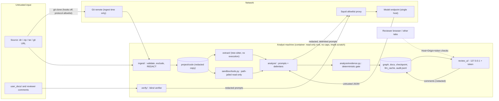

# Threat model (D-06)

Scope: the `migration-agent` CLI, its project folder, the ingestion engine, the analysis/verification
pipeline, the local review server, and the container sandbox. Verified by the red-team suite in
`tests/redteam/` (fixtures built at test time by `scripts/make_redteam.py`; inert payloads in
`eval/redteam/payloads.json`). Run: `PYTHONPATH=src .venv/bin/python -m pytest -q tests/redteam`.

## 1. Assets

| Asset | Why it matters |
|---|---|
| Customer source code and its history | Proprietary IP; must only leave the machine as redacted prompt text to the one model endpoint. |
| Credentials embedded in the customer repo (cloud keys, tokens, DB passwords, private keys) | Highest-impact leak: must never reach a prompt, trace, cache, checkpoint, graph, doc or review UI. |
| Operator credentials (`ANTHROPIC_API_KEY` in env/`.env`) | Spend and account abuse. Never written to disk by the tool; scrubbed from audit free text if echoed. |
| Integrity of the knowledge graph / understanding doc | Wrong or attacker-authored "facts" mislead a migration. Every claim must carry verifiable evidence. |
| Host filesystem and network of the analyst's machine | Must not be readable/writable/reachable through repo content. |
| Review state (`feedback/*.json`, token) | Reviewer decisions drive re-analysis; token grants write access to the UI. |

## 2. Actors

| Actor | Capability |
|---|---|
| A1 Malicious repo author | Controls every byte of the source (files, names, comments, archives, git metadata). Primary adversary. |
| A2 Hostile model output / prompt-injected model | Returns arbitrary JSON; may try to cite files outside the repo or invent graph items. |
| A3 Malicious web page in the reviewer's browser | Can make cross-origin requests to `127.0.0.1`, attempt DNS rebinding and CSRF. |
| A4 Malicious or careless user-doc author | Pastes credentials or injection text into `user_docs/` or review comments. |
| A5 Network observer / compromised dependency | Watches or redirects egress. Partly out of scope (see residual risks). |
| A6 Co-resident local user | Reads project folders or the review port. Out of scope beyond loopback binding and a per-run token. |

## 3. Trust boundaries

Boundaries that carry a control: (B1) source -> `ingest/`; (B2) `code/` -> prompts; (B3) prompts ->
network; (B4) model output -> graph; (B5) browser -> review server; (B6) process -> host (container).

## 4. Network egress allowlist

Exactly two destinations are permitted; everything else is denied by construction or by the container.

| # | Destination | When | Mechanism |
|---|---|---|---|
| E1 | Git remote named by the operator (`https`, `ssh`, `file` only) | `init`/`ingest` of a git URL, once | `ingest._git_clone`: `GIT_ALLOW_PROTOCOL=https:ssh:file`, `protocol.allow=never` baseline, `ext::`/`git://`/`http://`/`ftp://` rejected before any process starts. Local paths, zips and tarballs never spawn git. |
| E2 | The configured model endpoint, via the allowlisting proxy | `analyze`, `verify`, `resolve --reanalyze` without `--offline` | `LiteLLMClient` -> `litellm.completion` only. Container `model` profile: worker on an `internal: true` network; Squid (`docker/squid.conf`) permits `CONNECT` to one `dstdomain` on 443 and `deny all`. |

Loopback traffic to the review server (`127.0.0.1`, random port) is local only. `--offline` analysis,
`init`, `extract`, `render`, `audit`, `changelog` and archive/dir ingest open **no** sockets and spawn **no**
processes (`test_egress.py`). The in-process guard (`sandbox/guard.py`) can enforce the same allowlist inside a
worker as defense in depth.

## 5. Secrets handling

1. **Redact at the choke point.** `ingest/secrets.py::redact_text` runs on every copied file. Patterns: AWS
   access keys, GitHub tokens, Slack tokens, Stripe `sk_/rk_` keys, Google API keys, JWTs, URL-embedded passwords,
   `key/secret/password/token = value` assignments, and multi-line PEM private-key blocks. Values become
   `[REDACTED:<kind>]`; surrounding code is preserved so structure and line numbers stay valid.
2. **Credential files are withheld**, not copied: `.env`, `.env.*` (except `*.example|sample|template|dist`),
   `id_rsa/ed25519/...`, `*.pem`, `*.key`, `*.p12`, `*.jks`, `.netrc`, `.npmrc`, `.pgpass`, ... They appear in
   `IngestReport.exclusions` (`secret_file`) and as findings listing the kind only.
3. **Findings never contain the value** (`SecretFinding.preview` is the line with placeholders). `ingest_report.json`
   therefore is safe to share.
4. Because `code/` is already redacted, everything derived from it (facts, inventory, prompts, `llm_cache/`,
   `checkpoint/`, graph snapshots, `understanding.latest.md`, `graph.html`, review state) is redacted too.
5. **Defense in depth** at the other sinks: `AuditLog.record` redacts all string fields (error messages, commands);
   the verifier redacts user docs and the understanding doc before prompting; the review server and
   `review.comments/resolutions` redact comment/note/author text before it is stored or sent to re-analysis.
6. The operator API key lives only in the process environment; it is not written to the project folder
   (`test_nothing_secret_in_any_prompt_trace_cache_or_artifact` sets it and scans every artifact).

## 6. STRIDE threat table

Tests are in `tests/redteam/` unless noted. "Code" is under `src/migration_agent/`.

| ID | STRIDE | Threat | Mitigation (code) | Tests |
|---|---|---|---|---|
| T1 | Tampering / EoP | Path traversal or absolute paths in zip/tar entries write outside `code/` | `ingest._safe_rel` rejects `..`, absolute, drive-letter, NUL; extraction writes only to a staging dir under a temp root | `test_zip_traversal_and_absolute_entries_rejected`, `test_tar_traversal_rejected` |
| T2 | Tampering / Info disclosure | Symlink/hardlink escape in archive or directory | Archive links are validated then never materialised; hardlink targets must be archive-relative; directory walk uses `followlinks=False`, symlinks recorded as excluded and never read; files are copied by value | `test_zip_symlink_escape_rejected`, `test_tar_symlink_and_hardlink_escape_rejected`, `test_tar_links_not_materialised`, `test_directory_symlinks_not_followed_and_nothing_leaks`, `test_hardlink_in_source_dir_is_copied_by_value_only` |
| T3 | DoS | Symlink loops, FIFO/device files | `os.walk(followlinks=False)`; `lstat` + `S_ISREG` check before any open (FIFO previously **hung** ingest - fixed); tar special files rejected | `test_directory_fifo_does_not_hang_and_is_excluded`, `test_tar_device_files_rejected` |
| T4 | DoS | Decompression bomb, huge file count, nested archives | Declared-size, per-entry and overall ratio caps (100:1), streamed byte budget, file-count cap; nested archives are `binary`-excluded, never recursed | `test_zip_bomb_rejected_by_ratio_cap`, `test_zip_bomb_rejected_by_size_cap`, `test_tar_bomb_rejected`, `test_zip_file_count_cap`, `test_directory_file_count_cap`, `test_directory_total_size_cap`, `test_nested_archive_is_not_recursively_extracted` |
| T5 | EoP | Git hooks / submodules / LFS smudge / user git config execute or fetch during clone | `core.hooksPath=/dev/null`, empty `GIT_TEMPLATE_DIR`, `GIT_CONFIG_GLOBAL=/dev/null`, `--no-recurse-submodules`, `filter.lfs.*` neutralised and `GIT_LFS_SKIP_SMUDGE=1`, protocol allowlist, `--` before URL | `test_hooks_do_not_run_and_submodules_lfs_not_fetched`, `test_clone_command_is_hardened`, `test_dangerous_transports_rejected`, `test_option_injection_in_ssh_host_does_not_execute` |
| T6 | Tampering | Prompt injection via comments, strings, docstrings, file names | Untrusted text is wrapped in `<<<CODE_BEGIN>>>/<<<CODE_END>>>` (also FACTS/GRAPH/NOTE/DOC/CLAIMS); system prompts declare all of it DATA and that the model has no tools; single-pass `render()` stops placeholder re-expansion | `test_code_is_wrapped_in_exactly_one_delimiter_pair`, `test_system_prompt_is_static_and_declares_data_boundary`, `test_template_placeholders_in_code_are_not_re_expanded`, `test_filename_payload_stays_on_one_header_line` |
| T7 | Spoofing | Forged delimiters, fullwidth/zero-width homoglyphs, bidi/RTL "Trojan Source" | `module_analyzer.neutralize` strips bidi/zero-width characters and defangs `<<<NAME>>>` look-alikes in every substituted value; reanalysis notes and verifier docs use the same function | `test_forged_delimiters_and_homoglyphs_are_neutralised`, `test_neutralize_variants`, `test_bidi_and_invisible_characters_stripped_from_prompts`, `test_verifier_user_docs_are_delimited_and_forged_markers_neutralised`, `test_reanalysis_notes_cannot_forge_delimiters_or_inject` |
| T8 | Tampering | Injected model output (extra keys, tool calls, bad types, evidence outside repo) | `sanitize_patch` + pydantic schema drop unknown types/keys and force `chunk_id`; `evidence.verify_evidence` rejects absolute/`..`/symlink-escaping/non-existent evidence and unquoted claims (zero unverified evidence); verifier drops unknown kinds, unverifiable quotes, malformed IDs | `test_injected_model_output_does_not_reach_the_graph`, `test_sanitize_patch_drops_unknown_types_and_forces_chunk_id`, `test_evidence_check_rejects_paths_outside_code_dir`, `test_verify_evidence_rejects_injected_node`, `test_verifier_drops_hostile_model_findings` |
| T9 | Info disclosure / EoP | Agent tools read outside `code/` | `ReadOnlyTools` resolves symlinks and requires containment; rejects `..`, NUL, absolute outside paths; lists escaping links as `symlink-escaping` without targets; skips them in grep; exposes no write/exec/network method | `test_tools_refuse_paths_outside_code_dir`, `test_list_and_grep_do_not_leak_through_symlinks`, `test_tools_expose_no_write_exec_or_network_surface`; existing `tests/test_sandbox_tools.py`, `tests/test_sandbox_guard.py` |
| T10 | Info disclosure | Credentials in the repo reach prompts or persisted traces | See section 5 | `test_ingest_withholds_credential_files_and_redacts_the_rest`, `test_report_lists_findings_without_values`, `test_redaction_is_exact_and_keeps_surrounding_code`, `test_long_minified_line_secret_beyond_5000_chars_is_redacted`, `test_nothing_secret_in_any_prompt_trace_cache_or_artifact`, `test_audit_scrubs_credentials_in_free_text`, `test_review_server_state_never_contains_secrets` |
| T11 | Info disclosure | Data leaves the allowlist | See section 4 | `test_offline_pipeline_opens_no_connections_and_spawns_nothing`, `test_offline_pipeline_on_hostile_sources_still_no_network`, `test_archive_ingest_opens_no_connections`, `test_review_server_only_talks_to_loopback`, `test_llm_requests_go_only_through_the_injected_transport`, `test_process_guard_blocks_non_allowlisted_destinations`, `test_squid_allowlist_documents_single_model_host` |
| T12 | Spoofing / EoP | DNS rebinding against the review server | Bind `127.0.0.1` only (`serve` refuses other hosts); exact `Host` allowlist `127.0.0.1:<port>` / `localhost:<port>` | `test_binds_loopback_only`, `test_dns_rebinding_host_header_rejected`, `test_host_localhost_with_port_is_accepted` |
| T13 | Tampering | CSRF against comment/resolution endpoints | Per-run 192-bit token (constant-time compare) required in path/header/cookie; `Origin` and `Sec-Fetch-Site` checks on POST; `application/json` only (no simple-form POST); cookie `HttpOnly; SameSite=Strict`; 64 KiB body cap; no CORS headers | `test_token_required`, `test_token_in_header_or_cookie_accepted_wrong_rejected`, `test_cross_origin_post_rejected_and_nothing_written`, `test_simple_request_content_types_rejected`, `test_oversized_body_and_bad_json_rejected`, `test_unsupported_methods_and_no_cors`, `test_root_page_sets_hardened_cookie` |
| T14 | Info disclosure | Token leaked via `Referer`, caches, framing | `Referrer-Policy: no-referrer` on every response (incl. errors), `Cache-Control: no-store`, CSP with `default-src 'none'`, no external origins, `frame-ancestors 'self'`, COOP/CORP same-origin | `test_security_headers_on_every_response`, `test_error_responses_also_carry_no_referrer`, `test_page_has_no_external_resources_or_links` |
| T15 | Tampering | Stored XSS through comments, node names, findings, markdown | JSON API (`nosniff`); UI builds DOM with `textContent`; the single `innerHTML` use receives server-escaped, whitelisted markdown; graph payload JSON is `<`/`>`/`&`-escaped | `test_stored_xss_comment_is_inert`, `test_page_only_uses_innerhtml_for_server_escaped_sections`, `test_graph_page_escapes_hostile_node_names`, `test_markdown_rendering_escapes_html`; existing `tests/test_review_ui.py` |
| T16 | Repudiation | Actions cannot be reconstructed | Append-only `audit.jsonl` (monotonic `seq`, flock, input hash, model, tokens, cost) with secret scrubbing; graph snapshots versioned; reanalysis log | `tests/test_audit.py`, `test_audit_scrubs_credentials_in_free_text` |
| T17 | DoS / cost | Runaway spend or huge prompts | `Budget` (USD/tokens) hard stop, chunk token planning, response and line caps in tools | `tests/test_llm_litellm.py`, e2e cost tests |
| T18 | EoP | Malicious file names (control chars, bidi) forge prompt headers | Names containing control/bidi characters are withheld (`unsafe_name`) | `test_filenames_with_control_or_bidi_chars_are_withheld` |

## 7. Residual risks (accepted or open)

1. **Redaction is pattern-based.** A novel or low-entropy secret (a human-chosen password in a variable not named
   `password/secret/token/key`, a bare high-entropy string) will be sent to the model. Mitigation: review
   `ingest_report.json`, extend `PATTERNS`, consider an entropy detector. Redacted placeholders are best-effort.
2. **Prompt injection is mitigated, not solved.** Delimiters and instructions raise the bar; the hard guarantee
   comes from the output gate (schema + deterministic evidence verification + path containment). An injected model can
   still make *true-but-misleading* claims (e.g. mislabel a rule) that cite real lines, or lower quality of analysis.
   Human review of the doc is the control.
3. **`analyze/crossref.fence` and `gapfill`** use their own `<<<DATA ... DATA>>>` fence that only defangs the exact
   ASCII markers (no homoglyph/zero-width handling); `render()`-based prompts are fully neutralised. Follow-up:
   route `fence()` through `neutralize`.
4. **`ReadOnlyTools.grep` accepts model-supplied regex**: catastrophic backtracking (ReDoS) is bounded only by file
   and line caps. Not currently reachable from LLM output, but a future tool-calling loop must add a timeout/`re2`.
5. **No `api_base` in `LLMConfig`.** Model destination is whatever LiteLLM resolves (provider default or env);
   the hard egress guarantee is the container proxy (single `dstdomain`), not application code. The proxy allows by
   domain name, so DNS or the model host itself is a covert channel; pin the narrowest host.
6. **In-process guard is a tripwire**, not a boundary (ctypes/native code bypass); the container is the boundary.
   Docker profiles are reviewed but were not exercised in CI.
7. **Local review server**: a co-resident local user who can read the URL/token (shell history, process list) can
   act as the reviewer. No TLS (loopback only).
8. **Tree-sitter and document parsers** (`pypdf`, docx XML) process untrusted bytes in-process; a parser bug is a
   memory-safety/DoS risk. `docx` XML uses stdlib ElementTree (entity-expansion exposure on very old Pythons);
   mitigated by the container's memory/pid limits.
9. **Git history is not scanned**: only the checked-out tree at `--depth 1`; secrets in older commits are never
   fetched. A git remote you choose is trusted for availability, not content.
10. **Already-ingested projects** created before redaction hold unredacted `code/`; re-ingest to apply it.
11. **Comments added by editing `feedback/*.json` by hand** bypass `review.comments` redaction.
12. The `.env` loader reads the *tool's* `.env` (operator key). Do not place the operator `.env` inside an analysed repo.

## 8. Bugs found by the red-team suite (fixed)

| Finding | Fix |
|---|---|
| Ingest only *reported* secrets; raw values were copied to `code/` and sent to the model, cache, checkpoint, graph | `redact_text` at ingest, credential files withheld, new token patterns, long-line handling |
| FIFO/device file in a directory source hung ingest (`open()` on a FIFO) | `lstat`/`S_ISREG` gate before opening |
| Forged `<<<CODE_END>>>` and homoglyph/zero-width/bidi look-alikes were passed verbatim into chunk prompts | `neutralize()` + single-pass `render()` |
| File names appeared in the "trusted facts" part of the prompt | Facts and graph summary wrapped in untrusted `FACTS`/`GRAPH` delimiters; system prompt updated |
| Reanalysis notes only defanged ASCII `<<<`, kept bidi chars, and stored pasted secrets | `_defang` uses `neutralize`; comments/resolutions redacted on write |
| Audit entries could echo credentials via error text | `AuditLog.record` redacts all strings |
| Verifier sent user docs with pasted secrets to the model and wrote them to findings | Redact docs and understanding before prompting |
| Git clone honoured user git config / LFS filters / submodule defaults | Hardened env and flags (see T5) |
| Review server lacked COOP/CORP | Added headers (`Referrer-Policy: no-referrer` was already present) |
